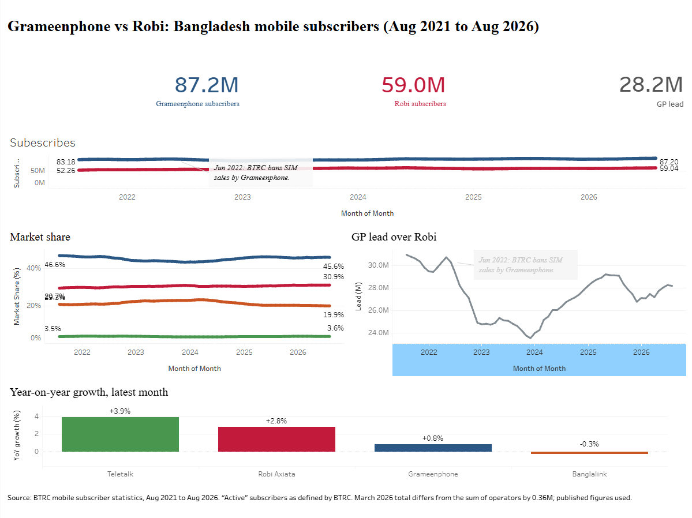

## Live dashboard

[View on Tableau Public](https://public.tableau.com/app/profile/md.abrar.hasnat/viz/GrameenphonevsRobiBangladeshmobilesubscribersAug2021toAug2026/Dashboard1)

## About the project

An interactive Tableau dashboard comparing Bangladesh's two largest mobile operators, **Grameenphone** and **Robi Axiata**, using five years of monthly subscriber data (Aug 2021 to Aug 2026) from the Bangladesh Telecommunication Regulatory Commission (BTRC). Banglalink and Teletalk are included for market-share context.

**Question:** How did the two rivals compare on subscribers and market share, and what happened to Grameenphone's lead around the June 2022 SIM-sales ban?

## Repository contents

| File | Description |
|---|---|
| `Gp_vs_robi_dataset_builder.ipynb` | Colab notebook that parses the BTRC table, validates it and builds the CSV |
| `gp_vs_robi_telecom.csv` | Final dataset used in Tableau (61 months × 4 operators = 244 rows) |
| `Grameenphone vs Robi Bangladesh mobile subscribers (Aug 2021 to Aug 2026).twb` | Tableau workbook |

## How it was made

1. **Choosing the comparison:** I first considered bKash vs Nagad and Pathao vs Uber, but neither has public per-company data. Mobile telecom works because BTRC publishes monthly subscribers for each operator.
2. **Collecting the data:** I copied BTRC's monthly subscriber table from its website into the notebook. The table uses Bengali month names and digits.
3. **Cleaning in Python (Google Colab):**
   - Parsed Bengali and English month names, spelling variants and Bengali digits.
   - Checked that the four operators add up to BTRC's published total, and that all 61 months are present.
   - Reshaped the data to one row per operator per month.
   - Added market share, month-on-month and year-on-year change, and a June 2022 event label.
   - Exported the final CSV.
4. **Building the dashboard in Tableau Public:** connected the CSV, created calculated fields (such as GP's lead over Robi), built four charts and three KPI tiles using each operator's brand colour, and arranged them on a fixed 1200 × 900 dashboard.
5. **Publishing:** saved the workbook to Tableau Public.

## Dashboard contents

- **Subscribers over time:** Grameenphone vs Robi, with the June 2022 SIM-sales ban marked
- **Market share:** share of all subscribers for all four operators
- **GP lead over Robi:** the gap in millions over time
- **Year-on-year growth:** latest-month growth for each operator
- **KPI tiles:** Grameenphone subscribers, Robi subscribers and Grameenphone's lead (Aug 2026)

## Key findings

- **Both grew, Robi faster:** Grameenphone grew from 83.18M to 87.20M subscribers (+4.8%) and Robi from 52.26M to 59.04M (+13.0%).
- **Market share barely moved:** Grameenphone slipped from about 46.6% to 45.6%, and Robi rose from about 29.3% to 30.9%.
- **The lead narrowed, but not steadily:** it fell from 30.9M to 28.2M overall, dropped sharply after the June 2022 ban, and then partly recovered.
- **Latest year:** Teletalk +3.9%, Robi +2.8%, Grameenphone +0.8%, Banglalink -0.3%.

## Dataset columns

| Column | Meaning |
|---|---|
| `month` | First day of the month |
| `operator` | Grameenphone, Robi Axiata, Banglalink or Teletalk |
| `subscribers` / `subscribers_m` | Subscribers (count / millions) |
| `industry_total_m` | BTRC's published total (millions) |
| `market_share_pct` | Operator share of the total (percent) |
| `mom_change_m`, `mom_pct` | Month-on-month change |
| `yoy_change_m`, `yoy_pct` | Year-on-year change |
| `is_focus_rival` | True for Grameenphone and Robi |
| `event_label` | Optional event note |
| `source` | Where the figure came from |

## Data notes

- Figures are BTRC's published "active" subscriber counts, so one person with several SIMs is counted more than once.
- BTRC's March 2026 total differs from the sum of the four operators by 0.36M. Published figures are used as is.
- The June 2022 ban is the only event marked. The lead fell after it, but this analysis doesn't prove it was the only cause.
- The "GP lead over Robi" chart doesn't start at zero, so swings look larger than they are.

## Reproduce it

1. Open the notebook in Google Colab.
2. Copy BTRC's mobile subscriber table into the `RAW_TEXT` cell.
3. Run all cells to download `gp_vs_robi_telecom.csv`.
4. Open the `.twb` file in Tableau and, if asked, point the data source to the CSV.

## Tools

Python (pandas), Google Colab, Tableau Public, GitHub

## Data source

Bangladesh Telecommunication Regulatory Commission (BTRC), mobile subscriber statistics: https://btrc.gov.bd/pages/static-pages/6922dda8933eb65569e15c3d
